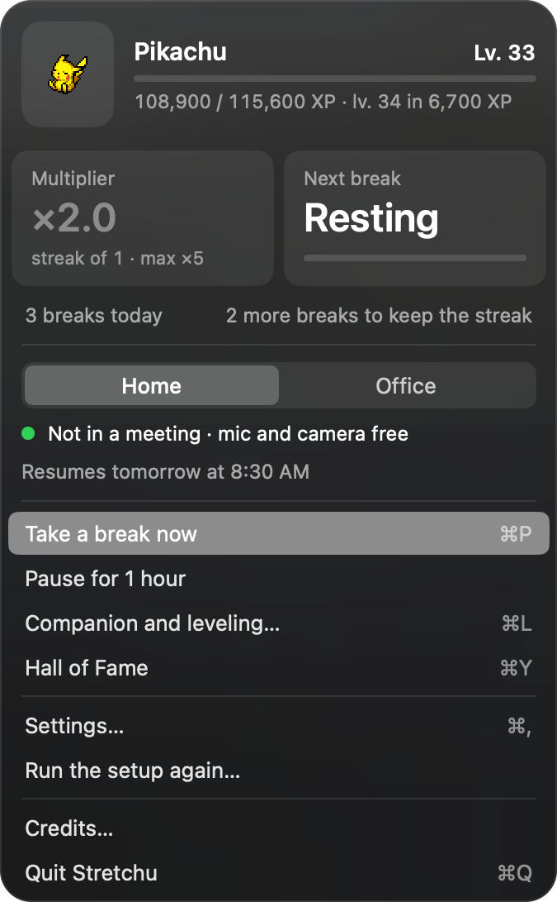
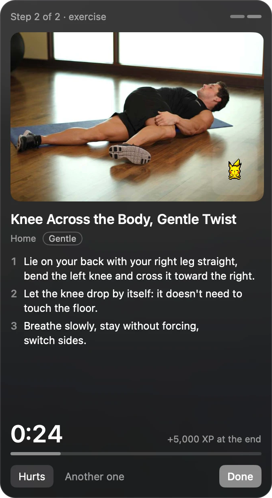
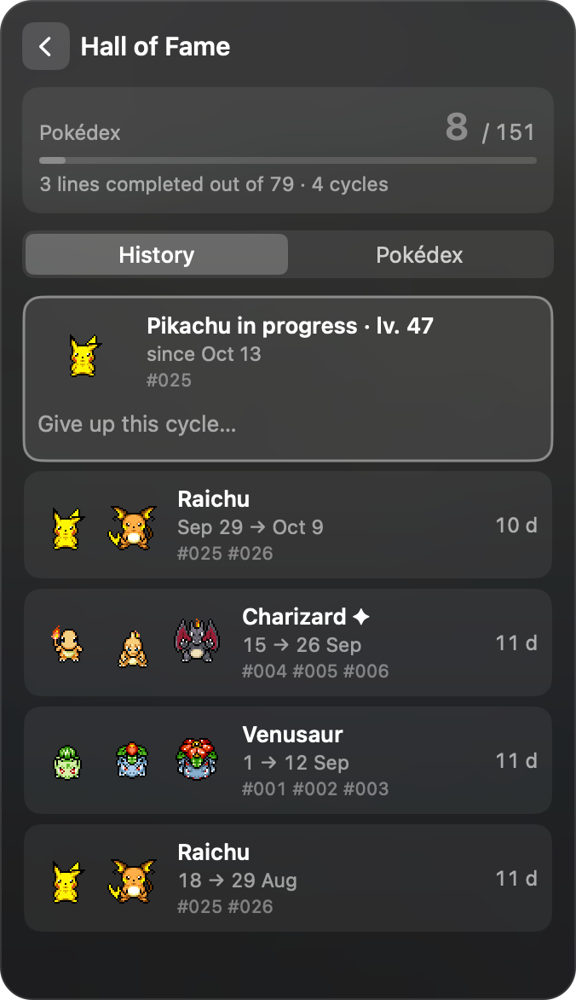

<p align="center">
  
</p>

<h1 align="center">Stretchu</h1>

<p align="center">
  <b>A break every 25 minutes. A Pokémon that grows with every one of them.</b><br>
  A macOS menu bar app for people who sit all day.
</p>

<p align="center">
  
  
  
</p>

- **Guided breaks.** Every 25 minutes: stand up, look far away, then a 30-second gentle stretch with
  pictures. Nothing to click during the first step, you can keep typing.
- **Never in a meeting.** If your microphone or camera is in use, Stretchu waits. It never listens
  or records.
- **A companion that levels up.** Every break gives XP. Your Pokémon evolves, enters the Hall of
  Fame at level 100, and you pick the next one, or let chance pick it (shiny included).
- **Your own program.** Describe your tight spots to an AI assistant, get a program file, import
  it. See [Create your program](docs/CREATE-YOUR-PROGRAM.md).
- **100 % local.** Native Swift, no account, no network access while it runs, no dependency.

> **Health notice.** Stretchu is not medical advice and does not replace a doctor or a
> physiotherapist. Stop any exercise that hurts. If you have a condition or pain, talk to a
> professional before following any routine.

> **Not affiliated** with Nintendo, Game Freak, Creatures or The Pokémon Company. The app's Pokémon
> sprites come from [PMD SpriteCollab](https://github.com/PMDCollab/SpriteCollab) and are downloaded
> on your Mac at build time: the code never ships them. See [CREDITS.md](CREDITS.md).

## Install (once per Mac)

Requirements: macOS 14 or later, and the Command Line Tools (no need for Xcode).

```bash
xcode-select --install   # only if `swift --version` fails
git clone https://github.com/Mgt-A/stretchu.git && cd stretchu && make install
```

`make install` first downloads the Pokémon sprites (about 16 MB, from PMD SpriteCollab, pinned to one
commit; `make sprites` runs it again), then builds in release mode, assembles `Stretchu.app`, signs it
ad hoc, copies it to `/Applications` and launches it. The icon shows in the menu bar, nothing in the Dock.

The first time, a setup window opens in the middle of the screen: language, Pokémon, equipment (home
and office), program, active hours, what Stretchu uses, a summary. Every step has a default and
"Skip" applies them all. The icon appears when it is finished, with the menu open once under it.

Once per Mac:

1. **Location**: accept the prompt on first launch. macOS requires it to read the Wi-Fi name
   (Home or Office mode). If you refuse, everything works with the mode chosen by hand in the
   menu. The ad hoc signature changes with every `make install`, so macOS may ask again after
   an update.
2. **Networks**: the first time you join a network, the menu offers "This network is: Home /
   Office". Everything can be changed in Settings (⌘,).
3. **Launch at login**: Settings, "Launch Stretchu at login". If macOS asks, approve it in
   System Settings, General, Login Items.

## Create your program

Stretchu ships one program, `general` (desk mobility, no equipment). To get one made for you, tell an
AI assistant where you feel tight and what you want from your breaks: it picks exercises from the
catalog and writes a small JSON file you import in Settings, Program.

- **With Claude Code**: a ready-made skill is in [`skill/stretchu-program`](skill/stretchu-program).
- **With any other assistant**: a prompt to paste.

Step by step, with examples: **[Create your program](docs/CREATE-YOUR-PROGRAM.md)**. File format:
[docs/PROGRAM.md](docs/PROGRAM.md).

## How it works

| When | What happens |
| --- | --- |
| 25 min of activity | The wake-up panel shows under the icon: Let's go / Later · 5 min (twice) / Skip |
| Step 1 | 30 s: stand up, sit back down, look 6 m or more away. Nothing to click, you can keep typing |
| Step 2 | 30 s exercise: Done / Hurts (hidden for good) / Another one |
| Meeting | Mic or camera in use: everything waits for the end of the meeting, the streak is safe |
| Idle 5 min or locked screen | The timer pauses |
| Outside your hours | Stretchu sleeps: no wake-up, no counter, the menu says when it resumes |

**Active hours.** By default 8:30 to 18:00, Monday to Friday; change them in the setup or in Settings
(quarter hours, any days). A day you leave off behaves like the weekend: it neither counts nor breaks
your streak. "Take a break now" still works outside the hours: it gives its XP with your multiplier,
but the streak does not move.

**Cycles.** At level 100 the Pokémon enters the **Hall of Fame** (menu, ⌘Y: your cycles, and a
151-slot Pokédex) and you choose the next one, by hand or at random. Eevee asks for an evolution stone
at level 50. You can give a cycle up from the Hall of Fame: it disappears from the history and the
Pokédex, your streak is kept. "Run the setup again…" in the menu replays the setup without touching
your progression.

The menu shows the level, the multiplier, the next break, Home / Office mode, "Take a break now"
(⌘P), "Pause for 1 hour", the companion (⌘L) and settings (⌘,). The companion and settings open
in place of the menu, with a back arrow (or Esc).

The interface is available in English and French and follows the system language.
`STRETCHU_LANGUAGE=fr` or `en` forces one (for example `STRETCHU_LANGUAGE=fr open /Applications/Stretchu.app`).

## Privacy

- No network access while the app runs. The network is only used by `git clone` and by
  `scripts/fetch-sprites.sh` (sprites), which `make install` runs when they are missing.
- Everything stays in `~/Library/Application Support/Stretchu`.
- Meetings are detected by asking macOS whether a microphone or camera is *in use*
  (`DeviceIsRunningSomewhere`). Stretchu never records or accesses audio or video, and macOS
  shows no permission prompt for it.
- Location is optional and only used by macOS to let the app read the Wi-Fi name.

## Update

```bash
cd stretchu && git pull && make install
```

Your state (level, streak, settings) is kept: it lives in
`~/Library/Application Support/Stretchu/state.json`, outside the repository.

## Uninstall

```bash
make uninstall                                   # quits the app and removes /Applications/Stretchu.app
rm -rf ~/Library/Application\ Support/Stretchu   # optional: erases level, streak and settings
```

If you enabled launch at login, untick Stretchu in System Settings, General, Login Items first.

## Development

Architecture, rules and conventions: [CONTRIBUTING.md](CONTRIBUTING.md).

```bash
make test                           # pure logic and localization, release and development builds
make debug                          # development build, launched in Debug mode
make demo STATE=lv65-x5           # loads a prepared state (Tests/Fixtures/), then launches in Debug
make demo STATE=charmander-lv32-almost LANGUAGE=en
```

Prepared states: `hall-of-fame-4-cycles`, `lv1`, `lv32-almost`, `lv33-x2`, `lv65-x5`, `lv99-streak39` (old format, they load
as the Pikachu line), `pikachu-lv49-almost`, `charmander-lv32-almost`, `eevee-lv49-almost`,
`eevee-flareon-shiny-lv60`. `make demo` drops the scenario in `state.debug.json`: your real state stays
untouched.

**Debug mode only exists in development builds** (compiled with `-DSTRETCHU_DEBUG`, which
`make debug` and `make demo` pass). `make install` builds without it: no Debug page, no ⌥ click
entry, no Debug dot on the icon, no `state.debug.json`.

In a development build, Debug is reached from the "Debug" row of the menu or by ⌥ clicking the
icon. The page has a toggle; it sets level, XP, streak, today's breaks and cycles, triggers
wake-up / level up / fake meeting / completed break / skip, simulates time (+25 min,
next workday, weekend) without touching the Mac's clock, forces each animation and the Home /
Office mode. Debug works on a copy (`state.debug.json`); turning the toggle off gives your real
state back.

A development build launched by `make debug` also accepts commands from a terminal:

```swift
DistributedNotificationCenter.default().postNotificationName(
    .init("ch.antoine.stretchu.debug"), object: nil,
    userInfo: ["command": "level:33"], deliverImmediately: true)
```

Commands: `wakeup`, `start`, `complete`, `skip`, `meeting`, `endmeeting`, `advance25`, `day`,
`weekend`, `real`, `level:N`, `xp:N`, `streak:N`, `breaks:N`, `cycles:N`, `fixture:<name>`,
`levelup`, `ssid:<name>`, `home`, `office`, `reset`, `panel`, `close`.

### Interface texts

English is the source: `Sources/Stretchu/Localization/en.lproj/Localizable.strings`. The French
translation is in `fr.lproj`. A test fails if a key is missing from one of them or used in the
code without a string.

### Exercises and programs

`Resources/Exercises/catalog.json` is the English catalog (90 exercises, from
[free-exercise-db](https://github.com/yuhonas/free-exercise-db) plus a few made for the app), with
`catalog.fr.json` for the French texts and the pictures next to them (about 6 MB, committed).
Program format: [docs/PROGRAM.md](docs/PROGRAM.md).

### Pokémon lines and sprites

`Resources/lines.json` lists the lines the app can use: every Gen 1 line, limited to Gen 1 species
(Pikachu starts at Pikachu). Two evolutions: levels 33 and 66. One evolution: level 50. None: the
same species up to level 100. Eevee branches at level 50 (Water, Thunder or Fire Stone). Gen 2 and
later are "coming soon". The file is generated by `python3 scripts/generate-lines.py` (PokeAPI) and
committed.

`scripts/fetch-sprites.sh` downloads, into `Resources/Sprites/` (git-ignored: no Pokémon pixel is in
the code), the animations of each species from PMD SpriteCollab at the commit pinned in
`lines.json`, the shiny variants, the artists' credits (shown in the app's Credits page) and the
three evolution stones from PokeAPI/sprites. Idle, Hop and Sleep are required (a line without them
is dropped, with a message); Eat, DeepBreath and LookUp only exist for about 27 species, the app falls
back to Idle for the others. At each choice of Pokémon there is a 20 % chance of a shiny (30 % with a
random pick), for lines whose species all have one.

## License

Code under the [MIT license](LICENSE). Sprites, exercises and their pictures keep their own licenses:
see [CREDITS.md](CREDITS.md).
